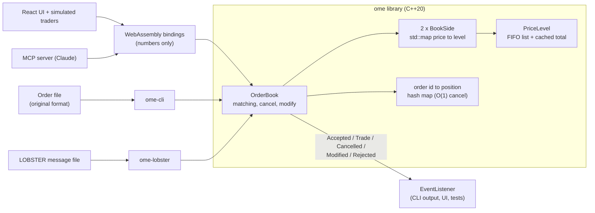

# Stock Order Matching Engine

[](https://github.com/rnm35/stock-order-matching-engine/actions/workflows/ci.yml)
[](https://rnm35.github.io/stock-order-matching-engine/)
[](https://github.com/rnm35/stock-order-matching-engine/releases)
[](LICENSE)

**Live demo:** https://rnm35.github.io/stock-order-matching-engine/ (the engine running as
WebAssembly in your browser, with simulated traders).

A C++20 limit order book and matching engine. It reads buy/sell orders, matches them with
price-time priority, and reports trades. It started as a university coursework program
(still in the git history: [`main/main.cpp` at 546e758](https://github.com/rnm35/stock-order-matching-engine/blob/546e7587f30b79a8a7dc157d34f1cfa767b9b811/main/main.cpp))
and was rebuilt to exchange-style standards; [PLAN.md](PLAN.md) records how, phase by
phase, with every measurement.

## Features

- Limit and market orders, partial fills, best-price-first then first-come-first-served.
- Time-in-force: GTC, IOC (fill what you can, cancel the rest), FOK (all or nothing).
- O(1) cancel; modify that keeps queue priority when only reducing size.
- Two matching modes:
  - **legacy**: the original coursework rules (below), with the original's bugs fixed.
  - **modern**: exchange-style; market orders never rest.
- Prices are integer ticks (1 tick = 0.01), never floating point.
- The library never prints; it reports `Accepted`, `Trade`, `Cancelled`, `Modified` and
  `Rejected` events through a listener interface.
- Compiles to WebAssembly: a live browser UI (depth chart, ladder, trade tape, order
  entry, simulated traders) and an MCP server that lets Claude trade on the book.

## Build

Requires CMake 3.25+ and a C++20 compiler (tested with GCC 16.2 and Clang 23, MinGW-w64 on
Windows). GoogleTest is fetched automatically for the tests.

```bash
cmake -S . -B build -DCMAKE_BUILD_TYPE=Release
cmake --build build -j
ctest --test-dir build --output-on-failure
```

CMake presets (`cmake --preset <name>`, `cmake --build --preset <name>`,
`ctest --preset <name>`): `release`, `debug`, `asan` (AddressSanitizer + UBSan),
`fuzz` (libFuzzer + sanitizers), `tidy` (clang-tidy, warnings as errors), all three with
Clang, and `wasm` (Emscripten; see "Web UI"). `cmake --build build --target format-check`
checks formatting (`format` fixes it).

## Testing

| Layer | What it checks | Where |
|---|---|---|
| Unit tests (GoogleTest) | Matching rules in both modes, cancel/modify, IOC/FOK, rejects, parser | `tests/*_test.cpp` |
| CLI end-to-end | Output files byte for byte, the four original bugs, default output names | `tests/data/` |
| Golden files | Legacy mode vs **the original coursework program** (with only its time-priority bug fixed) on hand-written and random inputs | `tests/golden/`, regenerate with `tools/make_golden.py` |
| Differential testing | `OrderBook` vs a deliberately naive O(n) `ReferenceBook` on random operation streams: every event and the final book must be identical, and the book's invariants must hold (level totals, never crossed) | `tests/support/`, `ome-difftest` |
| Coverage-guided fuzzing | libFuzzer on the text parser, and on byte-encoded operation sequences run through both books | `tests/fuzz/` |
| Sanitizers / static analysis | The whole suite under ASan + UBSan; clang-tidy on all sources | `asan`, `tidy` presets |

```bash
./build/tests/ome-difftest --ops 1000000 --seeds 20     # 40M operations, both modes
./build-fuzz/tests/book_fuzz -max_total_time=600 corpus_dir tests/fuzz/corpus/book_fuzz
```

Without libFuzzer (e.g. GCC), the fuzz targets are built with a simple random-input
driver so they still run in `ctest`.

## Run

```bash
./build/ome-cli examples/input1.txt
```

```
ome-cli <input> [-o output] [--mode legacy|modern] [--quiet]
  -o <file>       output file (default: input name with 'input' -> 'output',
                  otherwise 'output_<name>', in the input's directory)
  --mode <m>      legacy (original coursework rules, default) or modern
  -q, --quiet     don't print the book after every order
```

Unless `--quiet` is given, the book (both sides, best price first) is printed to the
console after every order. Invalid lines are reported on stderr with their line number and
skipped.

## Input File Format

1. **First line**: last traded price (decimal number)
2. **Each next line**: one order in the form:

```text
<order_id> <type> <quantity> [price]
```

- `<order_id>`: unique order identifier (string). A repeated id is rejected.
- `<type>`: `B` for buy or `S` for sell
- `<quantity>`: positive integer
- `[price]`: optional positive decimal with at most 2 decimal places. If omitted, the
  order is a **market order**.

### Example Input

```text
100.50
o1 B 100 101.25
o2 S 50 100.75
o3 S 100
o4 B 40
```

## Output File

Executed trades in the order they happened (buy side first, then sell side), followed by
every order with shares left over, in arrival order:

```text
order <id> <qty> shares purchased at price <p>
order <id> <qty> shares sold at price <p>
order <id> <qty> shares unexecuted
```

Output for the example above (legacy mode):

```text
order o1 50 shares purchased at price 101.25
order o2 50 shares sold at price 101.25
order o1 50 shares purchased at price 101.25
order o3 50 shares sold at price 101.25
order o4 40 shares purchased at price 101.25
order o3 40 shares sold at price 101.25
order o3 10 shares unexecuted
```

## Matching Behavior

An incoming order trades against resting orders on the other side, best price first and,
at the same price, in arrival order, until it is filled or nothing acceptable is left.

- An incoming **buy** limit accepts sells priced `<= buy_price`; an incoming **sell** limit
  accepts buys priced `>= sell_price`. Market orders accept any price.
- Executed quantity is `min(buy_qty, sell_qty)`. A partially filled resting order keeps its
  place in the queue.

### Legacy mode (default): the original coursework rules

- Unfilled market orders rest in the book and are matched before any limit order on
  their side.
- Execution price:
  - **Market vs Market**: the current last traded price.
  - **Market vs Limit**: the limit order's price.
  - **Limit vs Limit**: the price of the order that arrived first (the resting one).
- Any unfilled remainder stays pending.

### Modern mode

- Every trade prints at the resting order's price.
- Market orders never rest; an unfilled remainder is cancelled (and listed as unexecuted
  in the output file).
- IOC/FOK and cancel/modify are available through the library API (the CLI file format
  has no syntax for them yet).

### Fixed from the original

The original program (`main/main.cpp` in commit 546e758) had these bugs, all fixed and
covered by tests:

1. Ties at the same price were broken by comparing order ids as strings (`"o10" < "o2"`),
   and partially filled orders lost their place in the queue.
2. Every run printed a spurious `Invalid order format:` error.
3. Input names without a digit (e.g. `orders.txt`) crashed the program; paths like
   `data2/input1.txt` produced the wrong output name.
4. A missing input file was not detected.

## Design



Every caller goes through the same `OrderBook`; results come back only as events, so the
library never prints and holds no global state. Tests attach a recording listener; the
differential tests run a second, deliberately naive book on the same requests.

| Piece | Data structure | Why |
|---|---|---|
| Price levels, per side | `std::map<Price, PriceLevel>`; bids descending, asks ascending | `begin()` is always the best price; O(log L) insert of a new level |
| Orders at one price | `std::list<Order>` (FIFO) + cached total quantity | Append at the back, trade from the front; iterators stay valid so cancel is O(1); FOK checks and depth use the cached total |
| Order lookup | `std::unordered_map<OrderId, Locator>` (level iterator + list iterator) | O(1) cancel/modify without searching the book |
| Time priority | Per-order sequence number, assigned on arrival | Never inferred from the order id |
| Legacy market orders | Separate FIFO per side | They have no price and outrank every limit order on their side |
| Memory | All of the above are `std::pmr` containers on one `unsynchronized_pool_resource` per book | Freed nodes are reused without going back to the heap; measured gain below |

The original scanned every pending order, and for each one every earlier order, on every
match (roughly O(n³) over a run).

## Performance

All numbers measured on one machine: AMD Ryzen 5 5600X, 32 GB, Windows 10, GCC 16.2.0
(MinGW-w64), `-O3` Release build, single thread. Treat them as relative, not absolute.

**Against the original** (`tools/gen_orders.py N file 1`, legacy rules, same input):

| Orders | Original program | This engine, matching only | This engine, `ome-cli` end to end |
|---|---|---|---|
| 2,000 | 2.1 s | 0.20 ms | |
| 5,000 | 17.9 s | 0.53 ms | |
| 10,000 | 122.0 s | 1.06 ms | 0.30 s |

Original: `g++ -O2`, wall clock with console output to /dev/null. Matching only:
`ome-replay <file> --mode legacy --repeat 20` (orders parsed first, best of 20). End to end
includes process start-up and file I/O. Output files are identical.

**Throughput** on a realistic mix (45% limit orders, 30% of them marketable; 5% market;
40% cancels; 10% modifies) with the book held at a given depth:
`ome-bench --benchmark_repetitions=5` (median of 5).

| Resting orders | Requests/sec |
|---|---|
| ~1,000 | 12.5 M |
| ~10,000 | 8.9 M |
| ~100,000 | 5.1 M |

**Latency per request** on the same mix: `ome-latency --depth N --runs 6 --pin`
(every request timed with the CPU timestamp counter, 5M samples after a warm-up run;
includes ~16 ns of timer overhead; the timer resolution on this CPU is 10 ns).

| Resting orders | p50 | p90 | p99 | p99.9 | p99.99 |
|---|---|---|---|---|---|
| ~1,000 | 100 ns | 150 ns | 270 ns | 420 ns | 1.7 µs |
| ~10,000 | 120 ns | 210 ns | 360 ns | 560 ns | 2.0 µs |
| ~100,000 | 200 ns | 400 ns | 760 ns | 1.3 µs | 3.2 µs |

The maximum (not shown) is in the hundreds of microseconds: OS interrupts, which a
desktop machine can't exclude.

**Optimisations tried** (same workload, before -> after):

| Change | Result | Kept? |
|---|---|---|
| `std::pmr` pool allocator for all book nodes | Throughput 10.7 -> 12.5 M/s (1k), 8.6 -> 8.9 M/s (10k), 4.0 -> 5.1 M/s (100k); add+cancel 99 -> 70 ns; p99 at 100k 990 -> 760 ns. Repeat runs vary by about 5% | Yes |
| Flat per-tick price-level arrays instead of `std::map` | Not built: the book has ~100-260 levels, where a map lookup costs 20-23 ns (`BM_LevelLookup`). Only adds do that lookup, so the most it could save is about 5-10% of the mean request, at the cost of a bounded tick range | No |

**Real Nasdaq data.** `ome-lobster` replays LOBSTER message files (Nasdaq order flow
reconstructed from TotalView-ITCH). A trade's aggressor isn't in the file, only the
executions of the resting orders it hit, so for each execution the replay sends an IOC
order at that price and checks that **this** book fills the same resting order for the same
size: real order flow as a test of price-time priority. LOBSTER's free sample files, Level 1,
full trading day 2012-06-21, 1,041,889 messages:

| Stock | Messages | Replay speed | Executions reproduced exactly: messages only | ...reconciled with the orderbook file |
|---|---|---|---|---|
| AAPL | 118,497 | 15.0 M/s | 23.3% | 92.2% of 15,091 |
| AMZN | 57,515 | 15.8 M/s | 31.3% | 89.9% of 5,900 |
| GOOG | 49,482 | 15.5 M/s | 29.9% | 93.4% of 5,454 |
| INTC | 404,986 | 17.4 M/s | 44.7% | 63.4% of 24,931 |
| MSFT | 411,409 | 17.0 M/s | 45.0% | 64.2% of 24,779 |

Command: `ome-lobster <ticker>_..._message_1.csv --orderbook <ticker>_..._orderbook_1.csv`
(replay speed: messages only, best of 5). The data is licensed, so it isn't in the repo.

Why not 100%: a Level 1 file only contains events at the best bid and ask. An order that is
cancelled while it isn't the best leaves no message and stays in this book. Reconciling
removes any of our orders priced better than the true best (from the orderbook file) after
every message, which takes AAPL from 23% to 92%. What it can't remove are stale orders at
the best price itself. For AAPL and INTC, 99% and 96% of the remaining mismatches have an
order ahead in our queue that the file never mentions again, i.e. one Nasdaq removed without a
visible message. Orders resting before 09:30 are also missing entirely, which is why exact
best bid/ask *size* agreement is low (37% AAPL, 3% INTC, whose queues are deep). The rest,
0.1% (AAPL) to 2.1% (INTC) of checked executions, is unexplained; one hypothesis (a delete
plus re-add at the same price keeping queue priority) was tested and made the results
worse, so it was dropped. Deeper (Level 10) files should shrink the gap.

## Web UI (WebAssembly)

The same C++ library, compiled with Emscripten, runs in the browser behind a React +
TypeScript (Vite) front end:

- **Depth chart** (cumulative shares by price, hover for depth at a price) and **price
  ladder** (click a price to use it in the order form).
- **Order entry**: buy/sell, limit/market, GTC/IOC/FOK; **your orders** with fills, status
  and cancel; your levels and trades are highlighted in amber.
- **Trade tape** with the aggressor side.
- **Simulated traders** generate the flow: two market makers keeping layered quotes around a
  drifting fair value (re-quoting with `modify`, skewing prices against their inventory)
  and noise traders sending limit, market and IOC orders. Speed, which bots are active,
  and modern/legacy rules are adjustable.

```bash
# 1. Build the engine to WebAssembly (Emscripten SDK, EMSDK set) -> web/src/engine/wasm/
cmake --preset wasm && cmake --build --preset wasm
# 2. Run the app
cd web && npm install && npm run dev       # http://localhost:5173
npm test                                   # engine-through-wasm, simulation and MCP tests
npm run build                              # static site in web/dist/
```

**Crossing the JS/wasm boundary.** The first binding version built a JS object per event
field by field with embind; a request cost ~2.7 µs in Node, against ~0.1 µs natively. The
bindings now pass only numbers: side/TIF as small integer codes, and events, depth and
lookups come back as a flat `Float64Array` view of wasm memory (one boundary crossing),
decoded in TypeScript (`web/src/engine/engine.ts`). Measured cost per request, including
decoding into JS objects: 0.28-0.34 µs in Node 22, 0.27-0.37 µs in the browser (production
build; the "Engine µs/req" figure in the header, measured as one batch of 100,000 requests
because browsers coarsen `performance.now()` too much to time single calls).

## MCP server

`web/mcp/server.ts` exposes the book to an MCP client such as Claude, over stdio: tools
`get_book`, `place_order`, `cancel_order`, `list_orders`, `get_trades` and
`run_simulation` (let the bots trade). Claude trades as the user against the simulated
market; prices go in and out as decimal strings (`"100.25"`), converted to ticks exactly.

```bash
claude mcp add order-book -- node /path/to/repo/web/mcp/server.ts   # Claude Code
```

For Claude Desktop, add to `claude_desktop_config.json`:
`{"mcpServers": {"order-book": {"command": "node", "args": ["/path/to/repo/web/mcp/server.ts"]}}}`.
Needs Node 22.18+ (runs the TypeScript directly) and the wasm build. `OME_MODE=legacy` and
`OME_SEED=<n>` select the rules and the simulation seed.

## Limitations

- One instrument per `OrderBook`, single-threaded: a book is meant to be owned by one
  thread (the usual design: shard instruments across threads). No locking inside.
- Order types are limit and market with GTC/IOC/FOK. No stop, iceberg/reserve, pegged or
  post-only orders, no auctions, no self-trade prevention.
- Order ids only need to be unique among resting orders (the CLI rejects any repeat in a
  file).
- The per-book memory pool reuses freed nodes but returns memory to the system only when the
  book is destroyed.
- Performance numbers come from one desktop machine (see "Performance" for how); CI runs the
  benchmarks too, but shared runners are too noisy to quote.
- The LOBSTER replay can only check executions against orders visible in the file (see
  "Real Nasdaq data").
- The web simulation runs on the browser's main thread; at very high bot speeds the UI frame
  rate drops before the engine does.

## Repository Structure

```
include/ome/    public headers (order book, events, text format, LOBSTER adapter)
src/            library implementation
apps/cli/       ome-cli, the file-based front end
apps/lobster/   ome-lobster, LOBSTER (Nasdaq) message-file replay
wasm/           embind bindings (bindings.cpp) and their TypeScript types (ome.d.ts)
web/            React/Vite UI (src/ui), engine wrapper (src/engine), simulation and bots
                (src/sim), MCP server (mcp/)
bench/          ome-bench (Google Benchmark), ome-latency (percentiles), ome-replay
tests/          unit tests, CLI/golden tests (data/, golden/), reference book and
                differential harness (support/, differential/), fuzz targets (fuzz/)
examples/       sample input
tools/          gen_orders.py (random order files), make_golden.py (golden outputs)
.github/        CI, release and Pages workflows
```
